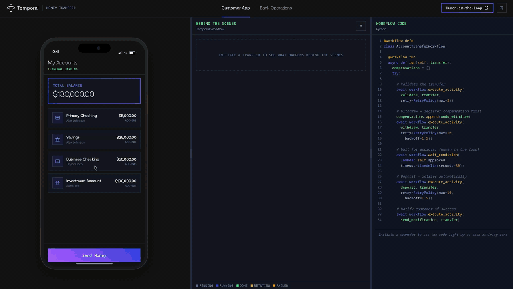

# Banking Transfer Demo — Temporal Money Transfer

A live, interactive demo showing how [Temporal](https://temporal.io) handles money transfers with durable execution. Send money through an iPhone-style banking app, watch the behind-the-scenes workflow execute in real time, and explore six different scenarios — from happy path to API downtime to human-in-the-loop approval.



## Quick Start

**Prerequisites:** Docker with Compose, and `make`. Everything else, including the Temporal dev server, runs in containers.

```bash
make demo                                  # Local Temporal dev server
make demo ENCRYPT=1                        # Local + payload encryption
make demo CLOUD_ENV=cloud.env              # Temporal Cloud
make demo CLOUD_ENV=cloud.env ENCRYPT=1    # Cloud + encryption
make down                                  # Stop it
```

Open http://localhost:5173 once it's running. Temporal UI at http://localhost:8233. `make help` lists the other targets: `dev` for an edit loop with reload, `worker` to rebuild the Worker alone, `reset` to terminate running transfers and clear the API's state, `test`, and `logs`.

`./scripts/start.sh` (with `--encrypt` and `--cloud-env <path>`) still works for running without Docker. It needs the [Temporal CLI](https://docs.temporal.io/cli), [uv](https://docs.astral.sh/uv/) and [Node.js](https://nodejs.org/) on the host.

To present the demo, follow [RUNBOOK.md](RUNBOOK.md): the walkthrough beat by beat, and where in the code each part happens.

## The Demo

### 1. Send a transfer (Happy Path)

Browse your accounts, pick a sender and recipient, enter an amount, and confirm. The behind-the-scenes panel shows each workflow activity executing. The code panel on the right shows the actual workflow code lighting up in real time. Drag the dividers between the three panels to resize them (double-click a divider to reset it), or fold a panel away with the button in its corner. The tabs under the code panel switch SDK language.

### 2. Explore the six scenarios

Click the **Scenario:** button in the top-right corner to switch scenarios:

| Scenario | What Happens | Key Temporal Feature |
|---|---|---|
| **Happy Path** | Validate, Withdraw, Deposit, Notify — all succeed | Basic workflow orchestration |
| **Advanced Visibility** | Same as happy path + search attribute updates at each step | Search attributes, observability |
| **Human-in-the-Loop** | Pauses for bank employee approval (30s timeout) | Signals, wait_condition, timeout |
| **API Downtime** | Deposit fails ~5 times, retries with backoff, then recovers | Retry policies, exponential backoff |
| **Bug in Workflow** | Intentional error after withdraw — compensation runs | Saga compensation, versioning concept |
| **Invalid Account** | Validation fails immediately, non-retryable | Non-retryable errors |

### 3. Bank operations tab

Switch to the **Bank operations** tab to act as a bank employee. When running the Human-in-the-Loop scenario, pending transfers appear here for approval or denial. You can also press **Approve transfer** in the **Waiting for approval** banner in the behind-the-scenes panel without leaving the customer app. If no one approves within 30 seconds, the workflow fails with `ApprovalTimeout`.

### 4. Inspect real workflows

The Temporal UI at http://localhost:8233 shows actual workflow executions with full event history.

## Payload Encryption

Launch with `ENCRYPT=1` to enable AES-GCM encryption on all workflow and activity payloads:

```bash
make demo ENCRYPT=1
```

This starts the worker with an encryption codec and a codec server on http://localhost:8081. The worker encrypts all payloads before they reach the Temporal server and decrypts them when they come back — the Temporal server never sees plaintext data.

**What you'll see in the Temporal UI:**
- All activity inputs/outputs show as `binary/encrypted` — unreadable
- To decrypt, click the 3D glasses icon in the Temporal UI and set the codec endpoint to `http://localhost:8081`
- Payloads are decrypted client-side in your browser — nothing goes back through the Temporal server

The backend does not use the codec. It starts workflows and sends signals to Temporal, but all sensitive data flows through the worker which handles encryption/decryption. The worker communicates results back to the backend via plain HTTP (internal API), outside of Temporal's data path.

## Temporal Cloud

To connect to Temporal Cloud instead of a local dev server:

```bash
cp cloud.env.example cloud.env
# Edit cloud.env with your namespace, address, and auth credentials
make demo CLOUD_ENV=cloud.env
```

The env file supports two authentication methods:

| Method | Variables |
|---|---|
| **API Key** (preferred) | `TEMPORAL_ADDRESS`, `TEMPORAL_NAMESPACE`, `TEMPORAL_API_KEY` |
| **mTLS certificates** | `TEMPORAL_ADDRESS`, `TEMPORAL_NAMESPACE`, `TEMPORAL_CERT_PATH`, `TEMPORAL_KEY_PATH` |

With `CLOUD_ENV`, no local Temporal server is started. The worker and backend connect directly to your Cloud namespace. Combine with `ENCRYPT=1` for encrypted payloads on Cloud.

## AWS Lambda Worker Container

The normal worker remains available through `uv run --package banking-demo-workflows worker` and `docker/worker-python.Dockerfile`. For Temporal Serverless Workers on AWS Lambda, build the Lambda-specific image:

```bash
docker build -f docker/worker-python-lambda.Dockerfile -t banking-demo-lambda-worker .
```

The image uses the AWS Lambda Python runtime and exposes this handler:

```text
banking_workflows.lambda_worker.lambda_handler
```

Set these Lambda environment variables when deploying the image:

| Variable | Purpose |
|---|---|
| `TEMPORAL_ADDRESS` | Temporal Cloud address, including port |
| `TEMPORAL_NAMESPACE` | Temporal namespace |
| `TEMPORAL_API_KEY` | API key auth, preferred for Lambda |
| `TEMPORAL_TASK_QUEUE` | Defaults to `MoneyTransfer` |
| `TEMPORAL_WORKER_DEPLOYMENT_NAME` | Worker Deployment name, defaults to `banking-transfer-demo` |
| `TEMPORAL_WORKER_BUILD_ID` | Worker Deployment Version build ID; must match the version registered in Temporal |
| `TEMPORAL_WORKER_VERSIONING_BEHAVIOR` | `PINNED` by default; can be `AUTO_UPGRADE` |
| `BANKING_BACKEND_URL` | Reachable backend URL for UI events and approvals |
| `BANKING_ENCRYPT` | Set to `1` to keep payload encryption enabled |

For mTLS, the handler also supports the existing `TEMPORAL_CERT_PATH` / `TEMPORAL_KEY_PATH` variables and the SDK names `TEMPORAL_TLS_CLIENT_CERT_PATH` / `TEMPORAL_TLS_CLIENT_KEY_PATH`, as long as the cert and key files are available inside the Lambda runtime.

When creating the Temporal Worker Deployment Version, use the same deployment name, build ID, task queue, and Lambda function ARN that you deployed in AWS.

## Architecture

```
Browser (React + Vite + Tailwind)
    | REST + SSE
FastAPI Backend (Python)
    |-- Mock Bank Services (validate, withdraw, deposit)
    |-- Internal API (failure state, SSE events, approvals)
    +-- Temporal client (starts workflows, sends signals)
           |
Temporal Dev Server (container, local profile)
           |
Python Worker [encrypts/decrypts payloads when ENCRYPT=1]
    |-- AccountTransferWorkflow (happy path)
    |-- AccountTransferWorkflowScenarios (dynamic, 5 other scenarios)
    +-- Activities -> Backend internal API

Codec Server (optional, ENCRYPT=1 only)
    |-- POST /encode — encrypts payloads
    +-- POST /decode — decrypts payloads for Temporal UI
```

Two workflow classes:
- **`AccountTransferWorkflow`** — clean happy path
- **`AccountTransferWorkflowScenarios`** — `@workflow.defn(dynamic=True)`, branches on workflow type name for the other 5 scenarios

## Transfer Flow

1. **Validate** — check accounts exist and amount is valid
2. **Withdraw** — remove funds from source account (register compensation first)
3. **[Approval]** — wait for bank employee signal (Human-in-the-Loop only)
4. **Deposit** — add funds to destination account (retries on API Downtime)
5. **Notify** — send success notification

**Compensation (saga pattern):** If any step after withdrawal fails, the workflow reverses the withdrawal automatically and notifies the customer. No manual intervention needed.

## Project Structure

```
├── frontend/              # React 19 + Vite + TypeScript + Tailwind 4
│   └── src/components/    # PhoneFrame, TransferTracker, BankOperations, etc.
├── backend/               # FastAPI + mock bank services (Python)
├── workflows/python/      # Python worker — two workflow classes + activities
│   └── src/banking_workflows/
│       ├── codec.py           # AES-GCM PayloadCodec (used when ENCRYPT=1)
│       └── codec_server.py    # HTTP codec server for Temporal UI decryption
├── docker/                # Dockerfiles (with test stages) + nginx config
├── docker-compose.yml     # Dev server (local profile), backend, worker, frontend, codec-server (encrypt profile)
├── docker-compose.dev.yml # Source mounts for make dev
├── Makefile               # make help lists the targets
└── scripts/start.sh       # Launcher for running without Docker
```

## Development

```bash
make dev     # The stack with source mounts: the API and frontend reload on save
make test    # Ruff on the Python packages; type-check, ESLint and build the frontend
```

The Worker doesn't reload in `make dev`. Restart it after an edit with `docker compose restart worker-python`.

### Without Docker

```bash
# Install dependencies
uv sync --all-packages && cd frontend && npm install

# Run individual services
temporal server start-dev                                                                # Temporal on :7233
uv run --package banking-demo-backend server                                             # FastAPI on :8000
BANKING_BACKEND_URL=http://localhost:8000 uv run --package banking-demo-workflows worker  # Python worker
cd frontend && npm run dev                                                               # Vite on :5173

# With encryption
BANKING_ENCRYPT=1 BANKING_BACKEND_URL=http://localhost:8000 uv run --package banking-demo-workflows worker
uv run python -m banking_workflows.codec_server                                          # Codec server on :8081
```

## Settings

Click the **Scenario:** button in the top-right corner to configure:
- **Scenario**: Happy Path, Advanced Visibility, Human-in-the-Loop, API Downtime, Bug in Workflow, Invalid Account
- **Presentation**: Simple (each step's service and attempt count) or Detailed (adds each step's result and error messages)
